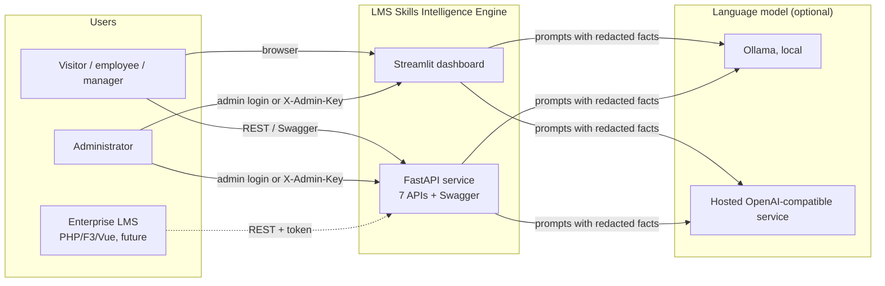
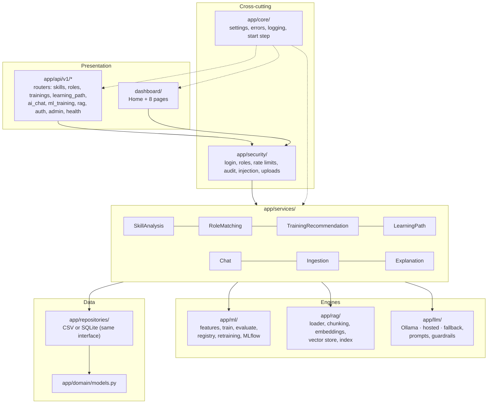
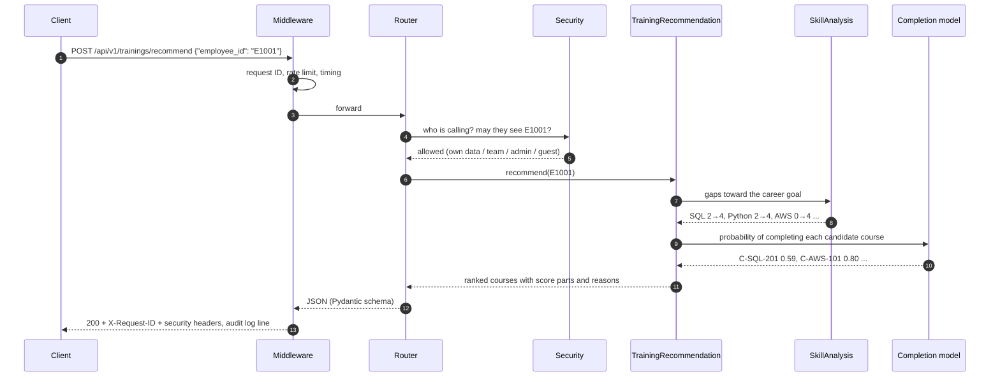
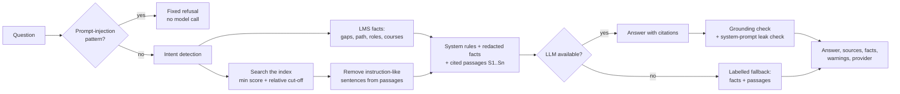
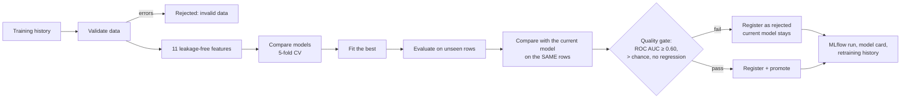
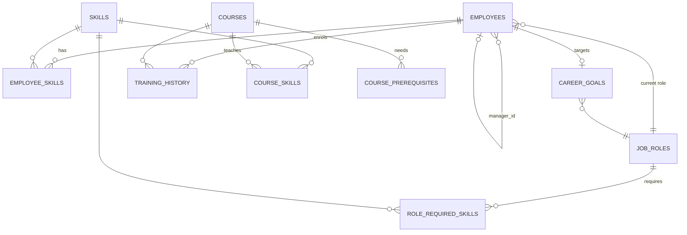
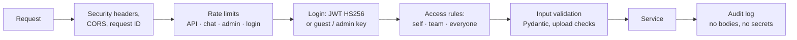
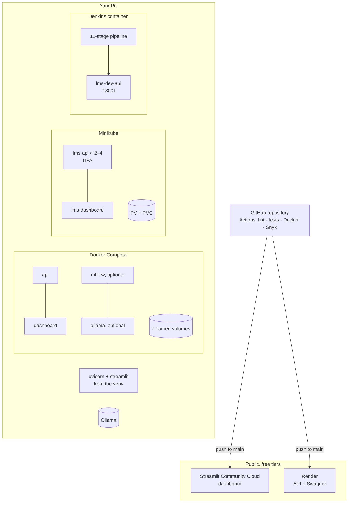

# Architecture

How the LMS Skills Intelligence Engine is built and deployed. GitHub renders the diagrams below (Mermaid).

---

## 1. System context

The dashboard and the API use the **same services** in the same code base, so they always show the same numbers. The language model is optional: without one, a clearly labelled fallback answers.

## 2. Layers inside the code

| Layer | Rule |
| --- | --- |
| Routers / pages | Validate input (Pydantic), check access, call one service, shape the response. No business logic |
| Services | All business logic; testable without HTTP |
| Repositories | The only code that knows where data lives: CSV files or SQLite, chosen by `DATA_SOURCE`. MySQL would be one more repository |
| Engines | ML, RAG and LLM behind small interfaces, so each can be replaced (e.g. another LLM provider) |

## 3. The seven APIs and what they use

| # | Endpoint | Service | Uses |
| --- | --- | --- | --- |
| 1 | `POST /api/v1/skills/analyze` | SkillAnalysis | employee skills, role requirements |
| 2 | `POST /api/v1/roles/match` | RoleMatching | TF-IDF role profiles + API 1 logic |
| 3 | `POST /api/v1/trainings/recommend` | TrainingRecommendation | API 1 gaps, course skills, prerequisites, completion model |
| 4 | `GET /api/v1/learning-path/{id}` | LearningPath | API 3 scores, prerequisite order; optional LLM explanation |
| 5 | `POST /api/v1/ai/chat` | Chat | APIs 1–4 facts, RAG index, LLM |
| 6 | `POST /api/v1/ml/retrain` | RetrainingService | data validation, training, quality gate, registry, MLflow |
| 7 | `POST /api/v1/rag/ingest` | Ingestion | loader, chunking, embeddings, vector store |

Supporting endpoints: health (`/health`, `/health/llm`, `/health/rag`), login (`/auth/token`, `/auth/me`), model status (`/ml/status`), documents (`GET/DELETE /rag/documents`), demo reset (`/admin/reset-demo`).

## 4. Request flow: a recommendation (API 3)

## 5. AI assistant: RAG and guardrails (API 5)

**Indexing (API 7 / start step):** documents (`.md .txt .pdf .docx .csv`) → text extraction → about 800-character chunks with 120 overlap and section paths → embeddings (Ollama `nomic-embed-text`, or TF-IDF) → FAISS (or NumPy) → swapped into place atomically, with `manifest.json`. Base documents are read-only; uploads are checked (type, size, content matches extension, no hidden instructions).

## 6. Machine learning lifecycle (API 6)

The current model version is read per request, so a promotion or rollback (dashboard or API) is used at once, even by other replicas on Kubernetes.

## 7. Data model

Eleven datasets, synthetic: 100 employees, 42 skills, 13 job roles, 80 courses, 925 employee skills, 554 training records. Columns and rules: `DATA_DICTIONARY.md`.

## 8. Security layers

Plus: PBKDF2 password hashes, tenant check, prompt-injection protection, start-up refusal of unsafe settings, non-root read-only containers, Snyk scans. Details: `SECURITY_GUIDE.md`.

## 9. Deployment views

| Environment | How it runs | Data | Guide |
| --- | --- | --- | --- |
| Local | `uvicorn app.main:app` + `streamlit run dashboard/Home.py` | CSV files, local index and models | `README.md` |
| Docker Compose | Hardened image, start step, 7 volumes | SQLite + index + models on volumes | `DOCKER_GUIDE.md` |
| Kubernetes | 2–4 API replicas, dashboard, PV/PVC, probes, limits | shared persistent volume | `KUBERNETES_GUIDE.md` |
| Jenkins | Build, test, scan, deploy `lms-dev-api`, smoke test | dev volumes | `JENKINS_CICD_GUIDE.md` |
| Public | Streamlit Community Cloud + Render, guest access | rebuilt from the repository at each start | `PUBLIC_DEPLOYMENT_GUIDE.md` |

## 10. Key design decisions

| Decision | Reason |
| --- | --- |
| Rules + ML hybrid for recommendations | Every score part is explainable; ML adds only what must be learned (completion) |
| One code base for API and dashboard | Same numbers everywhere; less code |
| Repository interface (CSV / SQLite) | The data source changes without touching services; ready for the LMS database |
| LLM behind a provider interface with a fallback | Works without a GPU; never pretends a fallback is AI |
| Start step (`app/core/prepare.py`) | Empty volumes or fresh hosts become a working system automatically; locked for multiple pods |
| Quality gate before promotion | A worse model can never silently replace a better one |
| Synthetic data only | Safe public demo; no personal data |
