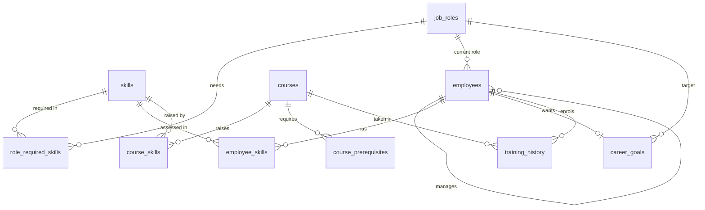

# Database Guide (Phase 9)

From Phase 9 the engine can keep the LMS data in a **SQLite database** as well as in CSV files. This guide explains why, how the tables are designed, how to create and switch to the database, and what changes when MySQL comes later.

## 1. Why a database?

| CSV files | Database |
| --- | --- |
| Rules are checked by our Python code (scripts 03–06) | The database **itself** refuses bad rows (keys, references, allowed values) |
| The whole file is loaded into memory | SQL fetches only the rows a question needs |
| One writer at a time, no transactions | Transactions: a change happens completely or not at all |
| Easy to open in Excel, easy to learn with | The standard way applications store data |

The CSV files stay. They are the input, and the default data source, so nothing has to be set up to run the API.

## 2. Why SQLite and Python's built-in `sqlite3`

- **SQLite** keeps the whole database in **one file** (`data/lms_ai.db`) and needs no server, so it is ideal for a first local version.
- **`sqlite3`** ships with Python, so there is nothing to install. All SQL is written by hand, which makes every query visible and easy to learn from.
- **The trade-off:** this layer only speaks SQLite. Moving to MySQL later means replacing it, for example with **SQLAlchemy** (one library for SQLite and MySQL) and **Alembic** (migrations). Only `app/database/` and the repository change: the services talk to the `LmsRepository` interface and never see SQL (section 9).

## 3. The tables

One table per CSV file, with the same name (without `.csv`) and the same columns. Every column is described in [`DATA_DICTIONARY.md`](DATA_DICTIONARY.md).



### Constraints: rules the database enforces

| Constraint | Meaning | Example |
| --- | --- | --- |
| `PRIMARY KEY` | Identifies a row; no duplicates | `(employee_id, skill_id)` in `employee_skills` |
| `FOREIGN KEY` (`REFERENCES`) | Must point to an existing row | `employee_skills.employee_id` → `employees` |
| `UNIQUE` | No two rows with the same value | `employees.email`, `skills.skill_name` |
| `CHECK` | Allowed values and ranges | `current_level BETWEEN 1 AND 5`, `status IN (...)`, `level_to > level_from` |
| `NOT NULL` | The value may not be empty | Everything except `manager_id`, `completed_date`, `score` |
| `STRICT` table | Refuses a value of the wrong type | The text `'ten'` in `duration_hours` |

Two SQLite details matter:
- **Foreign keys are off unless asked for.** `app/database/connection.py` runs `PRAGMA foreign_keys = ON` on every connection.
- **Dates** are stored as ISO text (`2026-10-31`), which sorts correctly. **Booleans** are `0` or `1`.

**Indexes** speed up "all rows for X" look-ups, for example `training_history (employee_id)`. A primary key is already indexed by its first column.

**Validation and constraints work together.** The Python checks explain *every* problem in plain language, with line numbers, so people can fix them. The constraints are the last line of defence: no program can store a broken row, however it was written.

## 4. Migrations: versioned changes to the tables

A **migration** is a numbered SQL file that changes the structure. `0001_create_lms_tables.sql` creates the 11 tables. Each database records which migrations it has run in the `schema_migrations` table, so `apply_migrations()` only runs new ones:

```
app/database/migrations/
  0001_create_lms_tables.sql     creates the 11 tables and indexes
  0002_...sql                    (future) e.g. add a column
```

Rules:
1. Each file runs inside a transaction: completely or not at all.
2. **Never edit a migration that has already run somewhere.** Add the next number instead, so every copy of the database can be upgraded the same way.

SQLite's `ALTER TABLE` can add or rename a column, but it cannot change a `CHECK` rule. For that, a migration creates a new table, copies the rows, drops the old table and renames the new one, all within its transaction.

To add one, create `app/database/migrations/0002_add_course_language.sql` containing `ALTER TABLE courses ADD COLUMN language TEXT NOT NULL DEFAULT 'English';`, then run script 14. Alembic and Flyway work the same way, with more features.

## 5. Create the database

```powershell
python data_science/14_save_to_database.py                       # sample data -> data/lms_ai.db
python data_science/14_save_to_database.py --data data/processed  # or the cleaned data from script 07
```

What the script does:
1. **Validates** the CSV folder with the same checks as scripts 03–06. If there are errors, it stops and creates nothing.
2. **Migrates:** creates the tables, or runs any new migration.
3. **Loads** all 11 tables in one transaction, replacing their contents. Parents are filled before children. Foreign-key checks are deferred to the end, because a manager can appear later in `employees.csv` than their team. If any row is refused, nothing changes.
4. **Queries:** a JOIN that reproduces API 1's gap score (37.5) in SQL, a GROUP BY for completion rates, and three bad inserts the database refuses.

Run it again at any time: the migrations are skipped and the data is reloaded.

## 6. Switch the API to the database

```powershell
# in .env
DATA_SOURCE=database
DATABASE_URL=sqlite:///./data/lms_ai.db
```

Restart uvicorn. The seven API contracts stay the same: APIs 1–4 now read through `SqliteLmsRepository`. The completion model's features (API 3) are read from the database too. Tests prove the database gives **exactly the same answers** as the CSV files, for every employee, role and course.

| `DATABASE_URL` | Meaning |
| --- | --- |
| `sqlite:///./data/lms_ai.db` | A file, relative to the project folder (default) |
| `sqlite:///D:/lms/lms_ai.db` | An absolute path on Windows |
| `sqlite:///:memory:` | A temporary database in memory (tests only) |

Any other URL, such as `mysql+pymysql://...`, is refused with a clear message in this version.

## 7. Browse the data

- **PyCharm Professional:** *Database* tool window → **+** → *Data Source* → *SQLite* → choose `data/lms_ai.db`.
- **PyCharm Community:** use the free [DB Browser for SQLite](https://sqlitebrowser.org).
- **Python:**
  ```python
  import sqlite3

  conn = sqlite3.connect("data/lms_ai.db")
  conn.execute("SELECT status, COUNT(*) FROM training_history GROUP BY status").fetchall()
  ```

## 8. Code map

| File | Purpose |
| --- | --- |
| `app/database/connection.py` | Turns `DATABASE_URL` into a configured connection (foreign keys on, rows by column name) |
| `app/database/migrate.py` | The migration runner |
| `app/database/migrations/*.sql` | The table definitions |
| `app/database/tables.py` | `save_datasets()` / `read_datasets()`: DataFrames ↔ tables, with identical types both ways |
| `app/repositories/sqlite_repository.py` | `SqliteLmsRepository`: the 11 repository questions answered with SQL |
| `data_science/14_save_to_database.py` | The learning script |
| `tests/unit/test_database.py`, `tests/api/test_database_source.py` | 22 + 6 checks |

**SQL habits in the code:**
- Values are always passed as **parameters** (`WHERE employee_id = ?`), never pasted into the SQL text. This prevents SQL injection.
- `ORDER BY rowid` returns rows in the order they were loaded, so lists match the CSV order.
- A fresh connection per repository call keeps things simple and safe when the API answers several requests at once.

## 9. Later: MySQL and the real LMS

| Step | What changes |
| --- | --- |
| Move to SQLAlchemy + Alembic | `app/database/` and a new `SqlAlchemyLmsRepository`; the migrations become Alembic revisions. Services, schemas and APIs stay the same |
| MySQL for this engine's own data | Only `DATABASE_URL` changes, e.g. `mysql+pymysql://lms_user:<password>@localhost:3306/lms_ai` (the password lives in `.env`, never in Git) |
| Read the company LMS database | A new read-only repository that maps the real LMS tables to the domain objects, in the separate integration project |

The repository tests (same answers as the CSV version) are the safety net for each step.

## 10. Troubleshooting

| Problem | Fix |
| --- | --- |
| `Database file not found: ...` | Run `python data_science/14_save_to_database.py` first, or check `DATABASE_URL` |
| `The database ... has no LMS data` | The file exists but is empty: run script 14 |
| `DATABASE_URL 'mysql+pymysql:...' is not supported yet` | Use a `sqlite:///` URL in this version |
| Script 14 stops with "Fix the errors first" | The CSV files have errors. Clean them (`07_clean_data.py`) and use `--data data/processed` |
| `database is locked` | Another program (for example DB Browser) is writing to the file. Close it, or click *Write Changes* there |
| API answers did not change after reloading | Restart uvicorn: the repository is created once at start-up |
