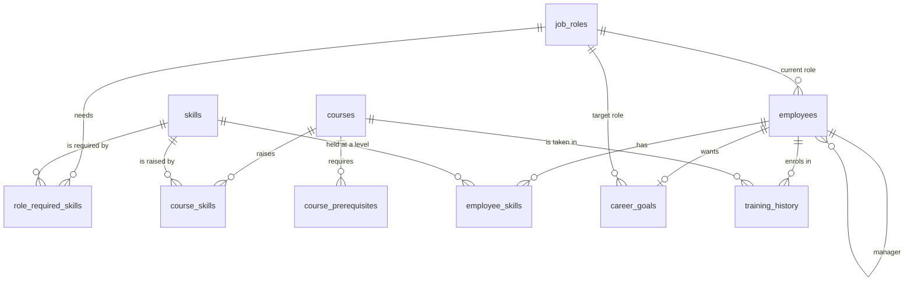

# Data Dictionary – Synthetic LMS Data

This guide explains every file and column in `data/sample/`. All data is **synthetic** (made up) and generated by `scripts/generate_synthetic_data.py`. No real person or company data is used; every email address ends in `@example.com`.

Data is "as of" **31 October 2026**: no date in the files is later than that.

## 1. The 11 files at a glance

| File | One row means | Rows | Key (unique) |
| --- | --- | --- | --- |
| `skills.csv` | one skill | 42 | `skill_id` |
| `skill_proficiency.csv` | one level on the 1–5 scale | 5 | `level` |
| `job_roles.csv` | one job role | 13 | `role_id` |
| `role_required_skills.csv` | one skill a role needs, at a level | 87 | `role_id` + `skill_id` |
| `courses.csv` | one training course | 80 | `course_id` |
| `course_skills.csv` | one skill a course raises, from → to | 84 | `course_id` + `skill_id` |
| `course_prerequisites.csv` | one "finish this course first" rule | 61 | `course_id` + `prerequisite_course_id` |
| `employees.csv` | one employee | 100 | `employee_id` |
| `employee_skills.csv` | one employee's level in one skill | 925 | `employee_id` + `skill_id` |
| `career_goals.csv` | one employee's target role | 63 | `employee_id` |
| `training_history.csv` | one course enrolment | 554 | `enrollment_id` |

A **key** is the column (or pair of columns) that identifies a row. No two rows share the same key.

## 2. How the files connect

An arrow means "refers to". For example, every `employee_skills.skill_id` must exist in `skills.skill_id`. These connections are called **foreign keys**, and the tests check every one of them.



(GitHub and PyCharm's Markdown preview draw this as a diagram.)

How the engine uses them in one sentence: **an employee's skills** (`employee_skills`) are compared with **a role's required skills** (`role_required_skills`) to find gaps; **courses** that raise those skills (`course_skills`) are recommended in **prerequisite order** (`course_prerequisites`), skipping courses already completed (`training_history`).

## 3. The proficiency scale (`skill_proficiency.csv`)

| Column | Type | Meaning |
| --- | --- | --- |
| `level` | integer 1–5 | The level number used everywhere else |
| `label` | text | Beginner, Elementary, Intermediate, Advanced, Expert |
| `description` | text | What a person can do at this level |

A missing skill (no row in `employee_skills`) is treated as **level 0**.

## 4. Column details

### `skills.csv`
| Column | Type | Example | Meaning and rules |
| --- | --- | --- | --- |
| `skill_id` | text | `SK004` | Unique ID, `SK` + 3 digits |
| `skill_name` | text | `SQL` | Unique, human-readable name |
| `category` | text | `Programming` | One of 7: Programming, Data Engineering, Data Analytics, Cloud & DevOps, Software Engineering, AI & ML, Professional |
| `description` | text | `Querying and managing data…` | Short explanation |

### `job_roles.csv`
| Column | Type | Example | Meaning and rules |
| --- | --- | --- | --- |
| `role_id` | text | `R004` | Unique ID, `R` + 3 digits |
| `role_title` | text | `Data Engineer` | Unique role name |
| `department` | text | `Data & Analytics` | Department the role belongs to |
| `job_family` | text | `Data` | Broader group of related roles |
| `seniority` | text | `Mid` | `Mid` or `Senior` |
| `description` | text | | Short explanation |

### `role_required_skills.csv`
| Column | Type | Example | Meaning and rules |
| --- | --- | --- | --- |
| `role_id` | text | `R004` | → `job_roles.role_id` |
| `skill_id` | text | `SK004` | → `skills.skill_id` |
| `required_level` | integer 1–5 | `4` | Level the role needs |
| `importance_weight` | decimal | `1.0` | How much this skill counts in scores. All `1.0` for now (equal weights); kept so weights can be tuned later |
| `is_mandatory` | True/False | `True` | `True` = must-have, `False` = nice-to-have |

### `courses.csv`
| Column | Type | Example | Meaning and rules |
| --- | --- | --- | --- |
| `course_id` | text | `C-SQL-201` | Unique. Pattern `C-<skill code>-<level>`; see the levels below |
| `course_title` | text | `SQL for Data Engineering` | Display name |
| `description` | text | | What the course does |
| `difficulty` | text | `Intermediate` | Beginner, Intermediate or Advanced |
| `duration_hours` | integer | `19` | Expected study time, 8–48 hours |
| `delivery_mode` | text | `Online` | Online, Blended or Classroom |
| `provider` | text | `Internal Academy` | Internal Academy, External Partner or Vendor Certification (fictional) |
| `is_active` | True/False | `True` | Inactive courses must not be recommended |

Course levels:

| Number | Difficulty | Raises a skill from → to |
| --- | --- | --- |
| `101` | Beginner | 0 → 2 |
| `150` | Intermediate | 0 → 3 (the only course for that skill) |
| `201` | Intermediate | 2 → 4 |
| `301` | Advanced | 4 → 5 |
| `401` | Advanced capstone | 3 → 4, for several skills at once |

### `course_skills.csv`
| Column | Type | Example | Meaning and rules |
| --- | --- | --- | --- |
| `course_id` | text | `C-SQL-201` | → `courses.course_id` |
| `skill_id` | text | `SK004` | → `skills.skill_id` |
| `level_from` | integer 0–4 | `2` | Level the learner should already have |
| `level_to` | integer 1–5 | `4` | Level the course brings the learner to; always above `level_from` |

### `course_prerequisites.csv`
| Column | Type | Example | Meaning and rules |
| --- | --- | --- | --- |
| `course_id` | text | `C-SQL-201` | → `courses.course_id` |
| `prerequisite_course_id` | text | `C-SQL-101` | → `courses.course_id`; must be completed first |

Rules: a course never requires itself, and there are no loops (A needs B needs A). Within a skill, 201 needs 101 and 301 needs 201. There are also cross-skill rules, e.g. `C-SPARK-101` needs `C-PY-101` and `C-SQL-101`.

### `employees.csv`
| Column | Type | Example | Meaning and rules |
| --- | --- | --- | --- |
| `employee_id` | text | `E1001` | Unique, `E1001`–`E1100` |
| `first_name`, `last_name` | text | `Arjun`, `Krishnan` | Fictional names (may repeat) |
| `email` | text | `arjun.krishnan@example.com` | Unique; always `@example.com` |
| `department` | text | `Engineering` | Same as the current role's department |
| `current_role_id` | text | `R001` | → `job_roles.role_id` |
| `manager_id` | text | `E1064` | → `employees.employee_id`; empty for the 10 managers at the top |
| `hire_date` | date `YYYY-MM-DD` | `2021-06-14` | |
| `location` | text | `Chennai` | One of 5 Indian cities |
| `employment_status` | text | `Active` | All active in this dataset |

### `employee_skills.csv`
| Column | Type | Example | Meaning and rules |
| --- | --- | --- | --- |
| `employee_id` | text | `E1001` | → `employees.employee_id` |
| `skill_id` | text | `SK004` | → `skills.skill_id` |
| `current_level` | integer 1–5 | `2` | Employee's current proficiency |
| `source` | text | `assessment` | `self` (self-rated), `manager` (manager-rated) or `assessment` (tested) |
| `assessed_date` | date | `2026-09-15` | When the level was recorded |

### `career_goals.csv`
| Column | Type | Example | Meaning and rules |
| --- | --- | --- | --- |
| `employee_id` | text | `E1001` | → `employees.employee_id`; at most one goal per employee |
| `target_role_id` | text | `R004` | → `job_roles.role_id`; never the employee's current role |
| `set_date` | date | `2026-02-01` | When the goal was set |
| `goal_status` | text | `Active` | All active in this dataset |

63 of the 100 employees have a goal. The other 37 can still be matched to roles, but the learning-path API needs a target role, either from this file or from the request.

### `training_history.csv`
| Column | Type | Example | Meaning and rules |
| --- | --- | --- | --- |
| `enrollment_id` | text | `EN0003` | Unique ID |
| `employee_id` | text | `E1001` | → `employees.employee_id` |
| `course_id` | text | `C-SQL-101` | → `courses.course_id` |
| `status` | text | `Completed` | `Enrolled`, `In Progress`, `Completed` or `Dropped` |
| `enrolled_date` | date | `2025-03-10` | Never before the hire date |
| `completed_date` | date or empty | `2025-04-02` | Only for `Completed`; on or after `enrolled_date` |
| `score` | integer 0–100 or empty | `84` | Only for `Completed` |
| `attempts` | integer | `1` | 1 or 2 |

Status mix: 296 Completed, 147 Dropped, 66 In Progress, 45 Enrolled.

## 5. The worked example (employee E1001)

From the project requirements: a Software Developer who wants to become a Data Engineer.

| Skill | E1001 current level | Data Engineer required | Mandatory |
| --- | --- | --- | --- |
| Python | 3 | 4 | Yes |
| SQL | 2 | 4 | Yes |
| AWS | 1 | 3 | Yes |
| Machine Learning | 2 | 2 | No |
| Docker | 2 | 3 | No |

E1001 (Arjun Krishnan, Chennai) has completed `C-PY-101`, `C-GIT-101` and `C-SQL-101`, and has a career goal of `R004` (Data Engineer). Later phases are tested against this example. For instance, `C-SQL-201` (SQL 2 → 4) should be among the first recommendations, because SQL is a large mandatory gap and its prerequisite `C-SQL-101` is already done.

## 6. How realistic patterns were built in

- **Skills follow roles.** Employees hold their role's skills near the required level (usually −2 to +1), plus 2–4 unrelated skills at levels 1–3. A non-mandatory role skill is sometimes missing.
- **Training follows careers.** Most courses an employee takes cover their current or target role's skills.
- **Completion follows simple rules, plus randomness.** A course is less likely to be completed when it starts well above the learner's level, or when its prerequisites were not completed. The ML model in Phase 8 can learn these patterns, but **only these patterns**: results on this data say nothing about real employees.
- **Managers.** Project Managers manage the PMO and Product & Business departments; Engineering Managers manage everyone else.

## 7. Regenerating the data

```powershell
python scripts/generate_synthetic_data.py              # recreate data/sample (seed 42)
python scripts/generate_synthetic_data.py --seed 7 --out data/raw/seed7   # a different, equally valid set
pytest tests/unit -v                                    # check integrity
```

The same seed always produces identical files. A test fails if `data/sample` is edited by hand, so never edit these CSVs directly. Change the generator and regenerate instead.

Deliberately "dirty" copies (missing values, duplicates, wrong types) for practising validation are created in Phase 3.
