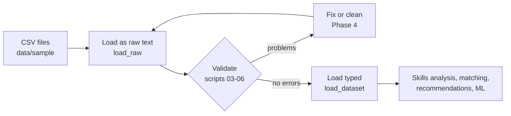

# Data Pipeline Guide

This guide walks through the data pipeline one script at a time. It is written for someone new to Pandas: run each script, read its output, then read the explanation here.

**Phase 3 covers scripts 01–06**: reading, inspecting and validating the data. Cleaning, EDA, features and modelling (scripts 07–15) follow in Phases 4 and 8.

## 1. Where the pipeline fits



The rule: **never feed unchecked data into the engine.** A wrong level, a missing skill ID or a duplicate employee would silently produce wrong recommendations.

## 2. Where the code lives

| File | What it does | Who uses it |
| --- | --- | --- |
| `app/data_processing/schemas.py` | Describes what correct data looks like: columns, types, ranges, allowed values, keys, references | Everything below |
| `app/data_processing/loader.py` | Reads CSV files into DataFrames, as raw text or with proper types | Scripts, API, dashboard |
| `app/data_processing/validators.py` | The checks. Each returns a list of `Issue`s | Scripts 03–06, tests, the upload page (Phase 4) |
| `data_science/01…06_*.py` | Short learning scripts that call the code above and explain the results | You |
| `scripts/make_dirty_data.py` | Makes a broken copy of the data for practice | You, tests |

The rules live in `app/`, not in the scripts. That way the upload page and the API (later phases) apply exactly the same checks.

## 3. Pandas in five minutes

| You want to… | Pandas | Example |
| --- | --- | --- |
| Make a table from Python data | `pd.DataFrame({...})` | `pd.DataFrame({"skill": ["SQL"], "level": [2]})` |
| Read a CSV file | `pd.read_csv(path)` | `pd.read_csv("data/sample/skills.csv")` |
| See the first rows | `df.head()` | `df.head(3)` |
| Count rows and columns | `df.shape` | `(100, 10)` |
| Pick one column | `df["col"]` | `df["email"]` |
| Keep matching rows | `df[condition]` | `df[df["location"] == "Chennai"]` |
| Count empty cells | `df.isna().sum()` | per column |
| Count values | `df["col"].value_counts()` | how many per department |
| Group and summarise | `df.groupby("col").size()` | employees per department |
| Text → numbers | `pd.to_numeric(col, errors="coerce")` | bad values become empty |
| Text → dates | `pd.to_datetime(col, format="%Y-%m-%d", errors="coerce")` | |
| Find repeated rows | `df.duplicated(keep=False)` | marks every copy |

A **mask** is a column of True/False values, one per row. Most checks build a mask of "bad" rows and then count it (`mask.sum()`) or filter with it (`df[mask]`). `~mask` flips True and False.

## 4. The scripts

Run every script **from the project folder** with your venv active. Each accepts `--data <folder>`; the default is `data/sample`.

### 01 – Create DataFrames and read CSV files
```powershell
python data_science/01_read_csv.py
```
You will see:
1. **The worked example as a DataFrame.** E1001's five skills with current and required levels.
2. **A whole-column calculation.** `gap = (required - current).clip(lower=0)` gives `Total gap = 6 levels; skills with a gap: 4 of 5`.
3. **What Pandas guesses** when reading `training_history.csv`. `score` becomes `float64` (decimals) because some cells are empty, and the dates stay text.
4. **Three ways of reading the same file side by side:** Pandas' guess, raw text, and properly typed (`Int64`, `datetime64`).
5. **All 11 files**, 2,014 rows in total.

### 02 – Inspect the data
```powershell
python data_science/02_inspect_data.py
python data_science/02_inspect_data.py --dataset training_history.csv
```
Shows `head()`/`tail()`, `info()`, `describe()` (split into text, numbers and dates), `nunique()`, `value_counts()`, a filter (employees in Chennai) and a `groupby` (employees per department). It ends with an overview of all files: rows, empty cells and duplicate rows.

**Empty does not mean wrong.** In clean data, `employees.csv` has 10 empty `manager_id`s (the top managers), and `training_history.csv` has empty `completed_date`/`score` for courses not yet completed. Scripts 03–06 decide what is really a problem.

### 03 – Validate the schema (columns and types)
```powershell
python data_science/03_validate_schema.py
```
| Finds | Severity |
| --- | --- |
| A required column is missing | error |
| An unexpected extra column | warning |
| Same columns in a different order | warning |
| A value of the wrong type, e.g. `ten` for a number, `31/12/2020` for a date, `yes` for True/False | error |

It runs first because the other checks look columns up by name.

### 04 – Validate nulls (empty values)
```powershell
python data_science/04_validate_nulls.py
```
It prints empty-cell counts per column and whether each column is required, then reports an error for every **required** column with empty cells. Optional columns (`manager_id`, `completed_date`, `score`) may be empty.

### 05 – Validate values, business rules and references
```powershell
python data_science/05_validate_values.py
```
| Kind | Example rule |
| --- | --- |
| Range | `current_level` 1–5, `score` 0–100, `duration_hours` 1–200 |
| Allowed values | `status` ∈ Enrolled, In Progress, Completed, Dropped |
| Format | IDs like `E1001`, `SK004`, `C-SQL-201`; emails contain `@` |
| Dates | Nothing after the data's as-of date, 2026-10-31 |
| Business rules (several columns of one row) | `level_to > level_from`; completed courses have a date and score, others do not; `completed_date ≥ enrolled_date`; nobody is their own manager |
| References (foreign keys) | Every `skill_id` in `employee_skills.csv` exists in `skills.csv`, and so on for all 14 links |

### 06 – Validate duplicates
```powershell
python data_science/06_validate_duplicates.py
```
It finds exact duplicate rows, repeated primary keys (for example, the same employee + skill entered twice with different levels) and repeated unique values (for example, the same email for two people). It prints the duplicated rows with their CSV line numbers.

### Reading the result table
```
dataset         check  severity column  rows lines       message
employees.csv   nulls  error    email   3    22, 23, 24  Required value is empty.
```
- **rows**: how many rows are affected.
- **lines**: CSV line numbers, up to 5 examples. Line 1 is the header, so DataFrame row 0 is line 2. You can jump straight to that line in PyCharm (Ctrl+G) or Excel.
- **severity**: `error` must be fixed; `warning` is worth a look.
- **Exit code**: 0 when there are no errors, 1 otherwise, so a CI pipeline can stop on bad data.

## 5. Practise on dirty data

```powershell
python scripts/make_dirty_data.py
python data_science/03_validate_schema.py --data data/raw/dirty
python data_science/04_validate_nulls.py --data data/raw/dirty
python data_science/05_validate_values.py --data data/raw/dirty
python data_science/06_validate_duplicates.py --data data/raw/dirty
```

The first command copies the clean data to `data/raw/dirty` and plants 17 problems. Try to predict what each script reports, then compare with the answer key in `data/raw/dirty/PLANTED_DEFECTS.md`:

| ID | File | Problem | Found by |
| --- | --- | --- | --- |
| D01 | courses.csv | extra column `legacy_code` | 03 (warning) |
| D02 | job_roles.csv | `seniority` renamed `seniority_level` | 03 |
| D03 | courses.csv | `duration_hours` = `ten` | 03 |
| D04 | employees.csv | `hire_date` written as DD/MM/YYYY | 03 |
| D05 | employees.csv | 3 empty emails | 04 |
| D06 | employee_skills.csv | 4 empty levels | 04 |
| D07 | courses.csv | 2 empty course titles | 04 |
| D08 | employee_skills.csv | levels 7 and 0 | 05 |
| D09 | training_history.csv | score 120 | 05 |
| D10 | training_history.csv | status `Complete` (typo) | 05 |
| D11 | course_skills.csv | `level_from` and `level_to` swapped | 05 (rule) |
| D12 | training_history.csv | completed before enrolled | 05 (rule) |
| D13 | employees.csv | 2 employees copied exactly | 06 |
| D14 | employee_skills.csv | same employee + skill twice, different levels | 06 |
| D15 | training_history.csv | `enrollment_id` reused | 06 |
| D16 | employee_skills.csv | `skill_id` SK999 does not exist | 05 (reference) |
| D17 | training_history.csv | `course_id` C-XYZ-101 does not exist | 05 (reference) |

Expected totals on the dirty data:

| Script | Result |
| --- | --- |
| 03 | 3 errors, 2 warnings |
| 04 | 3 errors |
| 05 | 8 errors |
| 06 | 5 errors |

Some defects produce more than one finding. For example, copying an employee row repeats the row, its ID and its email.

`data/raw/` is git-ignored, so regenerate the dirty copy whenever you like. Phase 4 adds `07_clean_data.py`, which fixes these problems.

## 6. Adding or changing a rule

1. Edit `app/data_processing/schemas.py`. For example, change `max_value` of `duration_hours`, or add a value to `allowed`.
2. For a rule across several columns, add a `BusinessRule` to `BUSINESS_RULES` in `validators.py`.
3. Run `pytest tests/unit -v`. The clean data must still give no issues, and every planted defect must still be found.
4. If a new rule should catch a new kind of problem, add a defect to `DEFECTS` in `scripts/make_dirty_data.py` so the tests prove it works.

## 7. Tests for this phase

```powershell
pytest tests/unit/test_data_validation.py -v
```
The 28 tests check two promises:
- **No false alarms:** clean data gives zero issues.
- **No misses:** all 17 planted defects are found.

They also check each rule on small hand-made DataFrames, and run every script on clean data (exit 0) and on dirty data (exit 1).
