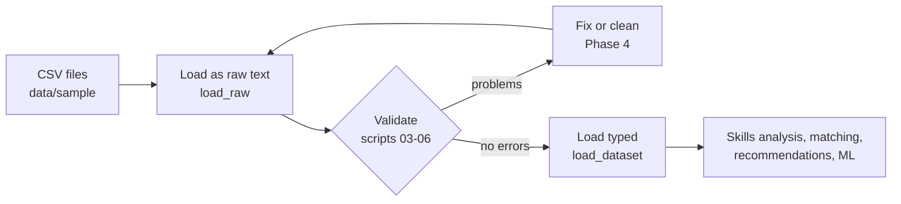

# Data Pipeline Guide

This guide walks through the data pipeline one script at a time. It is written for someone new to Pandas: run each script, read its output, then read the explanation here.

- **Phase 3:** scripts 01–06, reading, inspecting and validating the data.
- **Phase 4:** scripts 07 (cleaning), 08 (exploratory charts) and 15 (data-quality report), plus the CSV upload service.
- **Phase 8:** scripts 09–13, features and modelling.

## 1. Where the pipeline fits



The rule: **never feed unchecked data into the engine.** A wrong level, a missing skill ID or a duplicate employee would silently produce wrong recommendations.

## 2. Where the code lives

| File | What it does | Who uses it |
| --- | --- | --- |
| `app/data_processing/schemas.py` | Describes what correct data looks like: columns, types, ranges, allowed values, keys, references | Everything below |
| `app/data_processing/loader.py` | Reads CSV files into DataFrames, as raw text or with proper types | Scripts, API, dashboard |
| `app/data_processing/validators.py` | The checks. Each returns a list of `Issue`s | Scripts 03–06, tests, the upload page (Phase 4) |
| `data_science/01…06_*.py` | Short learning scripts that call the code above and explain the results | You |
| `app/data_processing/cleaning.py` | Fixes what is safe, quarantines the rest, logs everything | Script 07, later the upload flow |
| `app/data_processing/quality_report.py` | One PASS/WARN/FAIL summary of every check | Script 15 |
| `app/services/data_upload_service.py` | Checks an uploaded CSV: readable? which dataset? valid? | Dashboard and API |
| `scripts/make_dirty_data.py` | Makes a broken copy of the data for practice | You, tests |

The rules live in `app/`, not in the scripts. That way the upload page and the API (later phases) apply exactly the same checks.

## 3. Pandas in five minutes

| You want to… | Pandas | Example |
| --- | --- | --- |
| Make a table from Python data | `pd.DataFrame({...})` | `pd.DataFrame({"skill": ["SQL"], "level": [2]})` |
| Read a CSV file | `pd.read_csv(path)` | `pd.read_csv("data/sample/skills.csv")` |
| See the first rows | `df.head()` | `df.head(3)` |
| Count rows and columns | `df.shape` | `(100, 10)` |
| Pick one column | `df["col"]` | `df["email"]` |
| Keep matching rows | `df[condition]` | `df[df["location"] == "Chennai"]` |
| Count empty cells | `df.isna().sum()` | per column |
| Count values | `df["col"].value_counts()` | how many per department |
| Group and summarise | `df.groupby("col").size()` | employees per department |
| Text → numbers | `pd.to_numeric(col, errors="coerce")` | bad values become empty |
| Text → dates | `pd.to_datetime(col, format="%Y-%m-%d", errors="coerce")` | |
| Find repeated rows | `df.duplicated(keep=False)` | marks every copy |

A **mask** is a column of True/False values, one per row. Most checks build a mask of "bad" rows and then count it (`mask.sum()`) or filter with it (`df[mask]`). `~mask` flips True and False.

## 4. The scripts

Run every script **from the project folder** with your venv active. Each accepts `--data <folder>`; the default is `data/sample`.

### 01 – Create DataFrames and read CSV files
```powershell
python data_science/01_read_csv.py
```
You will see:
1. **The worked example as a DataFrame.** E1001's five skills with current and required levels.
2. **A whole-column calculation.** `gap = (required - current).clip(lower=0)` gives `Total gap = 6 levels; skills with a gap: 4 of 5`.
3. **What Pandas guesses** when reading `training_history.csv`. `score` becomes `float64` (decimals) because some cells are empty, and the dates stay text.
4. **Three ways of reading the same file side by side:** Pandas' guess, raw text, and properly typed (`Int64`, `datetime64`).
5. **All 11 files**, 2,014 rows in total.

### 02 – Inspect the data
```powershell
python data_science/02_inspect_data.py
python data_science/02_inspect_data.py --dataset training_history.csv
```
Shows `head()`/`tail()`, `info()`, `describe()` (split into text, numbers and dates), `nunique()`, `value_counts()`, a filter (employees in Chennai) and a `groupby` (employees per department). It ends with an overview of all files: rows, empty cells and duplicate rows.

**Empty does not mean wrong.** In clean data, `employees.csv` has 10 empty `manager_id`s (the top managers), and `training_history.csv` has empty `completed_date`/`score` for courses not yet completed. Scripts 03–06 decide what is really a problem.

### 03 – Validate the schema (columns and types)
```powershell
python data_science/03_validate_schema.py
```
| Finds | Severity |
| --- | --- |
| A required column is missing | error |
| An unexpected extra column | warning |
| Same columns in a different order | warning |
| A value of the wrong type, e.g. `ten` for a number, `31/12/2020` for a date, `yes` for True/False | error |

It runs first because the other checks look columns up by name.

### 04 – Validate nulls (empty values)
```powershell
python data_science/04_validate_nulls.py
```
It prints empty-cell counts per column and whether each column is required, then reports an error for every **required** column with empty cells. Optional columns (`manager_id`, `completed_date`, `score`) may be empty.

### 05 – Validate values, business rules and references
```powershell
python data_science/05_validate_values.py
```
| Kind | Example rule |
| --- | --- |
| Range | `current_level` 1–5, `score` 0–100, `duration_hours` 1–200 |
| Allowed values | `status` ∈ Enrolled, In Progress, Completed, Dropped |
| Format | IDs like `E1001`, `SK004`, `C-SQL-201`; emails contain `@` |
| Dates | Nothing after the data's as-of date, 2026-10-31 |
| Business rules (several columns of one row) | `level_to > level_from`; completed courses have a date and score, others do not; `completed_date ≥ enrolled_date`; nobody is their own manager |
| References (foreign keys) | Every `skill_id` in `employee_skills.csv` exists in `skills.csv`, and so on for all 14 links |

### 06 – Validate duplicates
```powershell
python data_science/06_validate_duplicates.py
```
It finds exact duplicate rows, repeated primary keys (for example, the same employee + skill entered twice with different levels) and repeated unique values (for example, the same email for two people). It prints the duplicated rows with their CSV line numbers.

### Reading the result table
```
dataset         check  severity column  rows lines       message
employees.csv   nulls  error    email   3    22, 23, 24  Required value is empty.
```
- **rows**: how many rows are affected.
- **lines**: CSV line numbers, up to 5 examples. Line 1 is the header, so DataFrame row 0 is line 2. You can jump straight to that line in PyCharm (Ctrl+G) or Excel.
- **severity**: `error` must be fixed; `warning` is worth a look.
- **Exit code**: 0 when there are no errors, 1 otherwise, so a CI pipeline can stop on bad data.

## 5. Practise on dirty data

```powershell
python scripts/make_dirty_data.py
python data_science/03_validate_schema.py --data data/raw/dirty
python data_science/04_validate_nulls.py --data data/raw/dirty
python data_science/05_validate_values.py --data data/raw/dirty
python data_science/06_validate_duplicates.py --data data/raw/dirty
```

The first command copies the clean data to `data/raw/dirty` and plants 17 problems. Try to predict what each script reports, then compare with the answer key in `data/raw/dirty/PLANTED_DEFECTS.md`:

| ID | File | Problem | Found by |
| --- | --- | --- | --- |
| D01 | courses.csv | extra column `legacy_code` | 03 (warning) |
| D02 | job_roles.csv | `seniority` renamed `seniority_level` | 03 |
| D03 | courses.csv | `duration_hours` = `ten` | 03 |
| D04 | employees.csv | `hire_date` written as DD/MM/YYYY | 03 |
| D05 | employees.csv | 3 empty emails | 04 |
| D06 | employee_skills.csv | 4 empty levels | 04 |
| D07 | courses.csv | 2 empty course titles | 04 |
| D08 | employee_skills.csv | levels 7 and 0 | 05 |
| D09 | training_history.csv | score 120 | 05 |
| D10 | training_history.csv | status `Complete` (typo) | 05 |
| D11 | course_skills.csv | `level_from` and `level_to` swapped | 05 (rule) |
| D12 | training_history.csv | completed before enrolled | 05 (rule) |
| D13 | employees.csv | 2 employees copied exactly | 06 |
| D14 | employee_skills.csv | same employee + skill twice, different levels | 06 |
| D15 | training_history.csv | `enrollment_id` reused | 06 |
| D16 | employee_skills.csv | `skill_id` SK999 does not exist | 05 (reference) |
| D17 | training_history.csv | `course_id` C-XYZ-101 does not exist | 05 (reference) |

Expected totals on the dirty data:

| Script | Result |
| --- | --- |
| 03 | 3 errors, 2 warnings |
| 04 | 3 errors |
| 05 | 8 errors |
| 06 | 5 errors |

Some defects produce more than one finding. For example, copying an employee row repeats the row, its ID and its email.

`data/raw/` is git-ignored, so regenerate the dirty copy whenever you like. Section 6 shows how `07_clean_data.py` fixes these problems.

## 6. Phase 4: clean, explore, report

### 07 – Clean the data
```powershell
python scripts/make_dirty_data.py
python data_science/07_clean_data.py --data data/raw/dirty
```
**The golden rule:** only fix a value when the right answer is clear; otherwise set the row aside (**quarantine**) with a reason. Guessing a skill level would put invented data into the recommendations.

| Fixed automatically | Quarantined (needs a person) |
| --- | --- |
| Renamed column `seniority_level` → `seniority` | Empty or out-of-range skill level (0, 7) |
| Extra column `legacy_code` dropped | Employee with an empty email |
| `Complete` → `Completed`; letter case | Completed before enrolled |
| `31/12/2020` → `2020-12-31` | Unknown IDs (SK999, C-XYZ-101) |
| Score 120 → 100 (capped) | The second copy of a repeated key |
| Empty course duration → median for that difficulty | Rows linked to a quarantined row (the cascade) |
| Empty course title → `Untitled course (C-…)`, flagged for review | |
| Swapped `level_from` / `level_to` | |
| Exact duplicate rows dropped | |

What you will see on the dirty data:
1. **Before:** `19 error(s), 2 warning(s)`.
2. **What was fixed:** 10 changes. Every one is written to `data/processed/cleaning_log.csv`.
3. **What was quarantined:** 69 rows, grouped by reason. Each row is saved in `data/processed/rejected_rows.csv` with its original line number and full content.
4. **After:** the cleaned files are validated again, and the result is `No problems found.`

**Why 51 extra rows disappear (the cascade).** Three employees have no email, so they are quarantined. Their 30 skill rows, 2 career goals and 19 enrolments would then point to employees that no longer exist, so those rows are quarantined too. The cleaner repeats the reference check until nothing changes. Fix the three emails at the source and re-run, and all those rows come back.

**Changing a policy.** All decisions sit at the top of `app/data_processing/cleaning.py`:

| Setting | Controls |
| --- | --- |
| `COLUMN_ALIASES` | Known alternative column names |
| `VALUE_TYPOS` | Known misspellings |
| `DATE_INPUT_FORMATS` | Accepted date formats |
| `CAP_OUT_OF_RANGE` | Which numbers may be capped instead of quarantined |
| `FILL_MISSING` | Which empty values may be filled, and how |
| `NEWEST_BY` | Which copy of a repeated key to keep |

For example, if your LMS treats email as optional, set `required=False` for `email` in `schemas.py`. Those 3 employees and their 51 linked rows are then kept. Also update planted defect D05 in `scripts/make_dirty_data.py`, because the tests expect an empty email to be an error.

Cleaning data that is already clean changes nothing: `python data_science/07_clean_data.py` on `data/sample` writes byte-identical files. A test checks this.

### 08 – Exploratory Data Analysis (charts)
```powershell
python data_science/08_eda.py
```
It saves 7 charts to `reports/eda/`; open them in PyCharm or File Explorer. New Pandas tools in this script:

| Tool | Used for |
| --- | --- |
| `merge()` | Joining two tables on a shared column, like SQL JOIN or Excel VLOOKUP |
| `pd.cut()` | Putting numbers into bands, e.g. score bands |
| `groupby().agg()` | Several summaries per group |

| Chart | Finding on the sample data |
| --- | --- |
| 01 Employees per department | Engineering is the largest (36 of 100) |
| 02 Skill levels | 47% of recorded skills are level 3 or above |
| 03 Most common skills | Python (77 employees), then SQL (73) |
| 04 How enrolments end | 67% of finished enrolments are completed |
| 05 Completion vs level jump | **74%** when a course fits the learner's level, **41%** when it starts 2+ levels higher |
| 06 Gap to own role | Senior Software Developers have the largest average gap (8.0 levels) |
| 07 Scores | Median 79 |

Chart 05 is the pattern the ML model in Phase 8 will learn. Chart 06 is a preview of the Skills Analysis API in Phase 5. **Remember:** the data is synthetic and was generated with these rules. The charts show the method working, not facts about real people.

Each chart has a single series, so there is no legend; the title states the finding. The colours come from the project's validated palette.

### 15 – Data quality report
```powershell
python data_science/15_data_quality_report.py --data data/raw/dirty --out reports/quality_dirty
python data_science/15_data_quality_report.py --data data/processed --out reports/quality_processed
```
It runs every check and writes `data_quality_report.md` (open it in PyCharm's Markdown preview) and `data_quality_issues.csv`.

| Status | Meaning |
| --- | --- |
| PASS | No errors and no warnings |
| WARN | Warnings only |
| FAIL | At least one error |

On the dirty data, 6 files FAIL. After cleaning, every file passes.

### The CSV upload service
`app/services/data_upload_service.py` is what the dashboard's upload page (and later an API) will call. You can try it from Python now:

```powershell
python -c "from app.services.data_upload_service import validate_upload; r = validate_upload(open('data/sample/courses.csv','rb').read(), 'my_export.csv'); print(r.dataset, r.detected_by, r.status)"
```
Expected output: `courses.csv columns valid`.

| Question | How it is answered |
| --- | --- |
| Can we read it? | `.csv` only, at most 10 MB, UTF-8 text (Excel's "CSV UTF-8" is fine), at least one data row |
| Which dataset is it? | From the file name, or else from the column headers (at least 60% must match) |
| Is it valid? | Schema, empty values, ranges, rules and duplicates, **plus references to the current versions of the other files** |

For example, a new `skills.csv` without SQL is reported as invalid, because 84 rows in three other files still use SQL.

A file that cannot be read at all raises an `UploadError` with a plain-language message, such as "The file is not UTF-8 text. In Excel, save it as 'CSV UTF-8'." `save_upload()` stores accepted files in `data/uploads/` and refuses invalid ones.

## 6a. Phase 8: the course-completion model

Scripts 09–13 walk through one machine-learning workflow, one step per script. Each saves its result, so you can open the files in between. The logic lives in `app/ml/`, which the API uses too.

```powershell
python data_science/09_feature_engineering.py   # -> data/processed/ml/features.csv
python data_science/10_split_data.py            # -> data/processed/ml/train.csv, test.csv
python data_science/11_train_model.py           # -> models/completion_model_v1.joblib + .json
python data_science/12_evaluate_model.py        # -> metrics, reports/ml/feature_importance.png
python data_science/13_predict.py               # -> E1001's probabilities and API 3 before/after
```

### 09 – Feature engineering
Builds one row per **finished** enrolment (443): 11 features and the label `completed`. It prints the completion rate per value of key features. For example, with one too-advanced skill only 46 % complete, against 74 % with none. **Leakage rule:** only information from before the enrolment is used; `score`, `attempts` and `completed_date` are never features.

### 10 – Split
Stratified 80/20 split with seed 42: 354 training rows and 89 test rows, each about 67 % completed. The test rows are kept aside until script 12.

### 11 – Train
Compares Logistic Regression, Decision Tree and Random Forest with 5-fold cross-validation on the training rows. The best (Logistic Regression, CV ROC AUC 0.637) is trained and saved as a **new version** in `models/`. Run it again and you get version 2; nothing is overwritten. Restart uvicorn so API 3 loads it.

### 12 – Evaluate
Tests the model on the 89 unseen rows: ROC AUC **0.693** against 0.5 for the "always completes" baseline. It also prints the confusion matrix and the coefficients, and saves a chart. Accuracy (0.685) is close to the baseline (0.663): on unbalanced data, accuracy alone hides how much the model really learned.

### 13 – Predict
Shows E1001's probability for 7 courses (C-AWS-101 0.80, C-MLOPS-201 0.44), then API 3's recommendations without and with the model. Use `--employee E1020` to try another person.

### Retrain or roll back
- Retrain: run 09–11 again (for example after uploading new training history), then restart the API.
- Roll back: `python -c "from app.ml.model_registry import set_current; set_current(1)"`, then restart.
- Switch the model off: set `USE_COMPLETION_MODEL=false` in `.env`.

## 6b. Phase 9: save to the database

```powershell
python data_science/14_save_to_database.py                        # data/sample -> data/lms_ai.db
python data_science/14_save_to_database.py --data data/processed   # the cleaned data instead
```

### 14 – Save to the database
1. **Validate** the folder (the checks from scripts 03–06). On errors it stops, and no database is created. Try `--data data/raw/dirty` to see this.
2. **Migrate:** run the numbered SQL files in `app/database/migrations/` that this database has not run yet. The first run creates the 11 tables; later runs print "nothing".
3. **Load** all tables in one transaction, replacing the old contents: 42 skills, 925 employee skills, 554 enrolments, and so on.
4. **Query:**
   - a `LEFT JOIN` rebuilds E1001's gaps for Data Engineer and the gap score 37.5;
   - a `GROUP BY` gives completion rates per difficulty (79 % / 65 % / 53 %), the same as Pandas in script 09;
   - three bad inserts (unknown employee, level 7, duplicate key) are refused by the database's constraints.

Then set `DATA_SOURCE=database` in `.env` and restart uvicorn to serve the APIs from the database. Details: [`DATABASE_GUIDE.md`](DATABASE_GUIDE.md).

## 7. Adding or changing a rule

1. Edit `app/data_processing/schemas.py`. For example, change `max_value` of `duration_hours`, or add a value to `allowed`.
2. For a rule across several columns, add a `BusinessRule` to `BUSINESS_RULES` in `validators.py`.
3. Run `pytest tests/unit -v`. The clean data must still give no issues, and every planted defect must still be found.
4. If a new rule should catch a new kind of problem, add a defect to `DEFECTS` in `scripts/make_dirty_data.py` so the tests prove it works.
5. The database has its own copy of the column rules (Phase 9). If the rule should also be enforced there, add a new migration such as `app/database/migrations/0002_....sql`; never edit `0001`. `test_tables_match_the_dataset_schemas` fails if a column is added in one place but not the other.

## 8. Tests

```powershell
pytest tests/unit/test_data_validation.py -v   # Phase 3: 28 tests
pytest tests/unit/test_data_cleaning.py -v     # Phase 4: cleaning, report, scripts 07/08/15
pytest tests/unit/test_upload_service.py -v    # Phase 4: upload service
pytest tests/unit/test_completion_model.py -v  # Phase 8: features, leakage, split, model, registry
pytest tests/unit/test_database.py -v          # Phase 9: migrations, constraints, round trip, same answers as CSV
```
The Phase 3 tests check two promises:
- **No false alarms:** clean data gives zero issues.
- **No misses:** all 17 planted defects are found.

They also check each rule on small hand-made DataFrames, and run every script on clean data (exit 0) and on dirty data (exit 1).

The Phase 4 tests check that:
- cleaning the dirty data gives files that pass every check;
- cleaning clean data changes nothing;
- every quarantined row keeps its line and reason;
- the cascade removes the right rows;
- the upload service accepts good files and explains bad ones.
